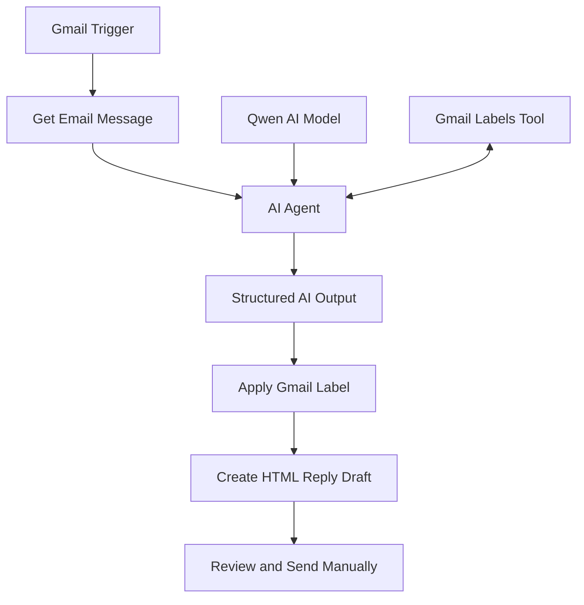

# 📧 SmartMail AI — Email Triage & Reply Assistant

**Automate your inbox with AI.** SmartMail AI is an n8n workflow that uses Gmail and Qwen AI to classify incoming emails, apply relevant Gmail labels, and generate professional HTML reply drafts for human review.

## 🚀 Overview

Managing emails manually can be repetitive and time-consuming. SmartMail AI streamlines this process by combining workflow automation with AI-powered email understanding.

The workflow monitors incoming emails, classifies them into predefined categories, labels the messages in Gmail, and prepares a suggested response as a draft — so you can review and send it yourself.

## ✨ Features

- 📥 **Automated Email Monitoring** — Checks Gmail for new emails every minute.
- 🧠 **AI-Powered Classification** — Categorizes emails into `course`, `doubt`, and `sponsership`.
- 🏷️ **Automatic Gmail Labeling** — Applies the corresponding Gmail label to each message.
- ✍️ **AI Reply Generation** — Drafts contextual, professional email responses.
- 🎨 **HTML Email Formatting** — Generates formatted replies for better readability.
- 📝 **Automatic Draft Creation** — Saves suggested replies in Gmail without sending them automatically.
- 🔗 **Gmail Integration** — Connects email retrieval, label management, and draft creation in one workflow.
- 🛡️ **Human-in-the-Loop** — Keeps the user in control of reviewing and sending replies.

## 🛠️ Tech Stack

| Technology | Purpose |
|---|---|
| n8n | Workflow automation |
| Gmail API / Gmail nodes | Retrieve emails, apply labels, and create drafts |
| Qwen AI | Email classification and reply generation |
| AI Agent | AI-driven workflow logic |
| Structured Output Parser | Organizes AI output into defined fields |
| HTML | Reply formatting |

## 🔄 Workflow Architecture

## ⚙️ How It Works

1. **Monitor:** The Gmail Trigger checks for new emails.
2. **Retrieve:** The workflow fetches the email details.
3. **Analyze:** Qwen AI processes the available subject and email snippet.
4. **Classify:** The AI selects an appropriate email category.
5. **Label:** The workflow applies the corresponding Gmail label.
6. **Generate:** The AI prepares a reply subject and HTML-formatted message.
7. **Save:** Gmail stores the response as a draft for review.

## 📋 Example Use Case

Suppose you receive an email about a course or certification program.

SmartMail AI can:

- Identify it as a course-related email.
- Apply the corresponding Gmail label.
- Generate a polite reply acknowledging the message.
- Save the response as an HTML-formatted draft.

You can then review, edit, and send the reply manually.

## 🚀 Setup and Installation

### Prerequisites

- An n8n instance (cloud or self-hosted)
- A Gmail account
- Gmail OAuth2 credentials configured in n8n
- A configured Qwen AI model connection

### Import the Workflow

1. Download the workflow JSON file from this repository.
2. Open your n8n instance.
3. Select **Import from File**.
4. Choose the downloaded workflow JSON.
5. Connect your own Gmail OAuth2 credentials.
6. Configure the Qwen AI model connection.
7. Verify that the required Gmail labels exist and that the AI returns the correct label IDs.
8. Test the workflow using a sample email.
9. Activate the workflow after successful testing.

**Note:** Credentials and account-specific references may need to be reconfigured after importing the workflow.

## 🔐 Security Best Practices

- Never publish API keys, OAuth tokens, passwords, or other secrets.
- Store credentials securely using n8n's credential manager.
- Remove sensitive execution data, personal email addresses, and account-specific information before publishing workflow exports.
- Test with non-sensitive emails before processing real messages.
- Review AI-generated replies before sending them.
- Grant only the Gmail permissions required by the workflow.

## ⚠️ Current Limitations

- The AI currently uses the email subject and snippet rather than the complete email body.
- Classification depends on the AI model's output and the configured Gmail label IDs.
- AI-generated drafts may require manual corrections.
- The workflow creates drafts; it does not automatically send replies.
- Error recovery and duplicate-processing prevention may require additional configuration.

## 🔮 Future Enhancements

- Full email-body analysis
- Improved classification accuracy and fallback categories
- Duplicate-email detection
- Retry logic and error notifications
- Classification confidence scores
- Human approval before sending
- Execution monitoring and analytics

## 💡 Why This Project?

SmartMail AI demonstrates practical applications of **AI agents, workflow automation, API integrations, structured outputs, and human-in-the-loop systems**.

It reduces repetitive inbox management tasks while keeping the user in control of outgoing communication.
## 🏗️ System Architecture

SmartMail AI integrates Gmail with Qwen AI through n8n to
classify incoming emails, apply labels, and create HTML reply
drafts for manual review.
## 👨‍💻 Author

**Ayush Gupta**

- GitHub: [@Ayushh890](https://github.com/Ayushh890)

---

⭐ If you find this project useful, consider giving the repository a star.

